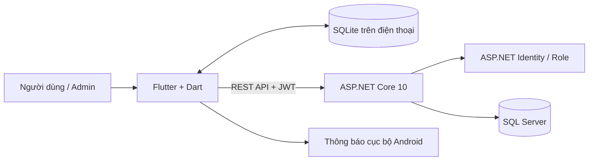
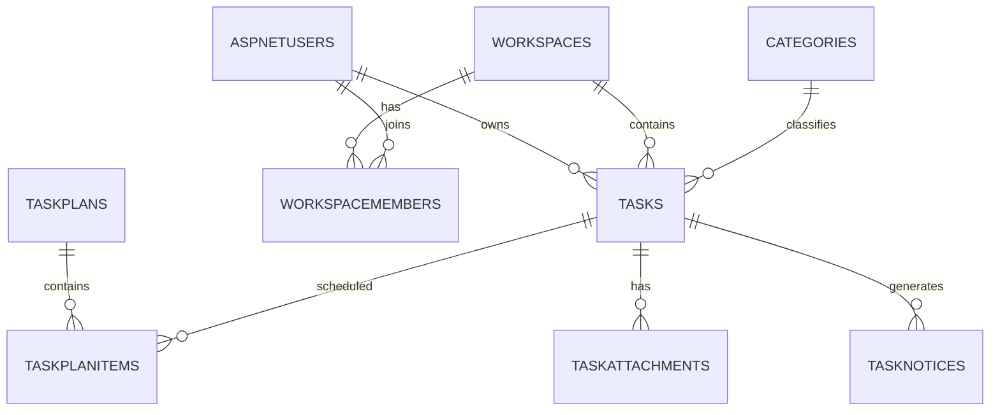

# Giải thích cơ chế ứng dụng TaskFlow

## 1. Bản trình bày khoảng một phút

> “TaskFlow là ứng dụng quản lý và nhắc việc cá nhân/nhóm. Giao diện viết bằng Flutter và Dart. Người dùng tạo việc, đặt hạn, mức ưu tiên và nhắc lặp. Trong nhóm, trưởng nhóm giao việc cho thành viên, theo dõi tiến độ và có thể yêu cầu làm lại. Ứng dụng gọi REST API ASP.NET Core 10; API dùng ASP.NET Identity/JWT để xác thực và phân quyền, sau đó lưu dữ liệu chung trên SQL Server. SQLite dùng lưu dữ liệu cục bộ trên điện thoại. Nhắc việc được lên lịch ngay trên thiết bị.”

## 2. Sơ đồ tổng quan



- **Flutter/Dart:** màn đăng nhập, đăng ký, tổng quan, nhiệm vụ, nhóm, thông báo, kế hoạch và quản trị.
- **SQLite:** dữ liệu local/cache và bảng `sync_queue` trên app native.
- **REST API:** kiểm tra xác thực/quyền, xử lý nghiệp vụ, trao đổi JSON.
- **SQL Server:** dữ liệu máy chủ dùng chung giữa tài khoản/thiết bị.
- **Local notification:** nhắc việc được xếp lịch tại thiết bị Android.

Ví dụ nhấn nút lưu nhiệm vụ:

```text
TaskEditorPage
  → Api.createTask(...) tạo JSON, gửi POST /api/tasks
  → TasksController.Create kiểm tra dữ liệu và quyền
  → AppDbContext thêm TaskItem
  → SQL Server lưu; API trả mã nhiệm vụ
  → Flutter cập nhật dữ liệu hiển thị/cục bộ
```

Trên Android, `TaskStore` dùng SQLite. Bản Web hiện tại dùng `_webTasks` trong bộ nhớ do SQLite plugin không hoạt động như trên điện thoại; tải lại trang có thể làm mất phần dữ liệu local. Khi trình bày yêu cầu SQLite, hãy dùng Android Emulator/điện thoại.

## 3. Cơ sở dữ liệu và ý nghĩa trường



| Bảng/entity | Ý nghĩa |
|---|---|
| `AspNetUsers`, `AspNetRoles` và bảng Identity | Tài khoản, mật khẩu hash, role và thông tin đăng nhập. Không lưu mật khẩu rõ. |
| `Tasks` / `TaskItem` | Nội dung, người sở hữu, người tạo, nhóm, danh mục, hạn, ưu tiên, trạng thái, cấu hình nhắc. |
| `Categories` | Danh mục công việc, ví dụ Đồ án, Backend, Cá nhân. |
| `Workspaces` | Nhóm, tên, mã tham gia và người trưởng nhóm. |
| `WorkspaceMembers` | Liên kết tài khoản với nhóm, vai trò Leader/Member, thời điểm tham gia/rời. |
| `TaskPlans` | Thông tin chung của kế hoạch và tài khoản sở hữu kế hoạch. |
| `TaskPlanItems` | Bảng nối task với plan, có thứ tự và giờ dự kiến. |
| `TaskAttachments` | Metadata của file; file thật nằm dưới `App_Data/TaskFiles`. |
| `TaskNotices` | Thông báo, ví dụ trưởng nhóm yêu cầu thành viên làm lại. |
| `TaskComments`, `TaskReminders` | Entity cho bình luận và nhắc ở API. |
| SQLite `tasks`, `sync_queue` | Bản cục bộ và các thao tác chờ đồng bộ trên app native. |

Ba trường cần phân biệt:

- `OwnerId`: ai chịu trách nhiệm/được giao.
- `CreatedByUserId`: ai tạo nhiệm vụ.
- `WorkspaceId`: nhiệm vụ thuộc nhóm nào; `null` thường nghĩa là việc cá nhân.

Ví dụ Phát tạo “Tạo API danh mục” cho Anh trong nhóm: `CreatedByUserId = Phát`, `OwnerId = Anh`, `WorkspaceId = nhóm đồ án`.

## 4. Tài khoản, đăng nhập và quyền

### Đăng ký và đăng nhập

1. Flutter gửi thông tin đăng ký/đăng nhập dưới dạng JSON tới `/api/auth/register` hoặc `/api/auth/login`.
2. ASP.NET Identity tạo tài khoản và áp quy tắc mật khẩu; đăng nhập sẽ so khớp mật khẩu hash và kiểm tra tài khoản có hoạt động.
3. Tài khoản mới mặc định role hệ thống `Member`. Nếu chọn tạo nhóm, API tạo `Workspace`, sinh mã mời và thêm người đăng ký làm `Leader` của nhóm.
4. Đăng nhập thành công, API trả JWT, user ID và role. App gửi JWT ở header `Authorization: Bearer <token>` cho request cần đăng nhập.

### Role hệ thống và vai trò nhóm

- **Admin** quản trị tài khoản, nhóm, role và xem/quản lý danh sách nhiệm vụ admin.
- **Member** dùng chức năng thường trong phạm vi nhiệm vụ cá nhân và nhóm đã tham gia.
- **Leader/Member của Workspace** là vai trò trong nhóm, khác role hệ thống Admin/Member.
- UI có thể ẩn nút, nhưng API mới bảo vệ dữ liệu bằng `[Authorize]`, `[Authorize(Roles = "Admin")]` và kiểm tra membership/leader.

### Google và quên mật khẩu

- Google login: app lấy ID token; API xác minh token bằng cấu hình OAuth Client ID rồi tạo phiên TaskFlow hoặc liên kết tài khoản.
- Quên mật khẩu: API tạo token reset; nếu SMTP được cấu hình thì gửi email. Trong Development chưa có SMTP, API có thể trả token kiểm thử; không dùng cách này khi phát hành.
- OAuth Client ID/SHA-1 và SMTP App Password là cấu hình bên ngoài, không commit bí mật vào Git.

## 5. Công việc cá nhân và nhóm

### Cá nhân

- `WorkspaceId` rỗng và `OwnerId` là chính tài khoản.
- Người dùng có thể tạo, sửa, xóa, hoàn thành; task có thể chứa hạn, ưu tiên, category và nhắc lặp.
- Khi xác nhận hoàn thành, trạng thái chuyển sang Done/khóa. App hủy notification của task đó.

### Nhóm

1. Người tạo nhóm nhận mã tham gia; người khác nhập mã để tham gia.
2. Leader tạo task thuộc `WorkspaceId`, chọn thành viên đang hoạt động làm người nhận.
3. API xác nhận người gọi là leader và người nhận còn trong nhóm.
4. Thành viên cập nhật task được giao; leader có thể xem tiến độ và quản lý task.
5. Khi thành viên rời, hệ thống đặt `LeftAt`, giữ lại membership history và nhiệm vụ gắn với nhóm để tra cứu theo lịch sử.
6. Nếu leader yêu cầu làm lại task đã Done, API trả task về Todo, mở khóa và ghi `TaskNotice` cho thành viên.

### Nhắc lặp

Task có thể lưu `DueAt`, `ReminderIntervalMinutes`, `ReminderUntil`. Ví dụ nhắc mỗi 5 phút tới 10 giờ: app lập các thông báo cục bộ trong khoảng đó. Cần quyền notification; Android có thể trì hoãn thông báo nếu chế độ tiết kiệm pin hạn chế app nền.

### Kế hoạch công việc

- `TaskPlan` là phần đầu kế hoạch: tên, chủ sở hữu, thời điểm tạo và xác nhận.
- `TaskPlanItem` nối plan với nhiều task, lưu thứ tự và `PlannedFor`.
- API chỉ thêm được task cá nhân của người dùng hoặc task ở nhóm họ đang tham gia.
- Bản nháp có thể thêm/gỡ task và xếp giờ. Chỉ xác nhận được khi có ít nhất một task.
- Nếu Admin xóa task đang trong plan, API gỡ dòng liên kết để không vướng khóa ngoại.

## 6. Tìm kiếm và phân trang

Flutter gọi `GET /api/tasks` với các tham số có thể gồm `q`, `status`, `categoryId`, `from`, `to`, `ownerId`, `workspaceId`, `page`, `pageSize`, `sort`.

API xử lý như sau:

1. Xác định phạm vi user được xem dựa trên role, chủ task và nhóm.
2. Thêm bộ lọc tìm kiếm/trạng thái/danh mục/ngày.
3. Đếm `total` sau lọc.
4. Sắp xếp, sau đó `Skip((page - 1) * pageSize).Take(pageSize)`.
5. Trả `{ items, total, page, pageSize }`; Flutter dùng `total` để bật/tắt “Tải thêm”.

Nói ngắn: **lọc trước, đếm kết quả, rồi lấy trang cần xem**.

## 7. Upload file

App gửi `multipart/form-data` đến `POST /api/tasks/{id}/attachments`. API kiểm tra quyền, định dạng và dung lượng tối đa 15 MB, tạo tên file lưu ngẫu nhiên. SQL Server lưu metadata; file thật ở `App_Data/TaskFiles/{taskId}`. Khi xóa phải dọn cả metadata lẫn file vật lý.

## 8. Trạng thái và độ ưu tiên

| Số | Enum | Hiển thị |
|---:|---|---|
| 0 | `Todo` | Cần làm |
| 1 | `InProgress` | Đang làm |
| 2 | `Done` | Hoàn thành |
| 3 | `Archived` | Đã lưu trữ |

Priority: `0 Low`, `1 Normal`, `2 High`, `3 Urgent`.

## 9. Một số endpoint tiêu biểu

| Endpoint | Chức năng |
|---|---|
| `POST /api/auth/register`, `POST /api/auth/login` | Đăng ký/đăng nhập |
| `POST /api/auth/forgot-password`, `POST /api/auth/reset-password` | Quên/đặt lại mật khẩu |
| `POST /api/auth/change-password` | Đổi mật khẩu |
| `GET/POST/PUT/DELETE /api/tasks` | Đọc/tạo/sửa/xóa nhiệm vụ (ID ở thao tác đơn) |
| `PATCH /api/tasks/{id}/status` | Cập nhật trạng thái |
| `POST /api/tasks/{id}/request-rework` | Leader yêu cầu làm lại |
| `GET/POST /api/groups`, `POST /api/groups/join` | Đọc/tạo/tham gia nhóm |
| `GET/POST/DELETE /api/plans` | Đọc/tạo/xóa plan; route con xử lý items/xác nhận |
| `GET/POST/PUT/DELETE /api/admin/members` | Quản lý tài khoản, yêu cầu Admin |
| `GET/POST/PUT/DELETE /api/categories` | Đọc/quản lý danh mục; thao tác ghi yêu cầu Admin |

## 10. Những điểm cần nói đúng giới hạn

- Development tạo/nâng schema và dữ liệu demo; môi trường phát hành nên dùng EF Core migrations và secrets an toàn.
- Bản Web dùng bộ nhớ `_webTasks` cho local, không thay thế SQLite native; trình bày SQLite trên Android.
- Nhắc lặp hiện là local notification; không gọi là push notification từ server.
- Google và SMTP cần cấu hình OAuth/SMTP hợp lệ bên ngoài repo.
- Nút bị ẩn không có nghĩa là đã phân quyền; API phải tự kiểm tra.
- SQLite là database cục bộ; SQL Server là database phía server.
