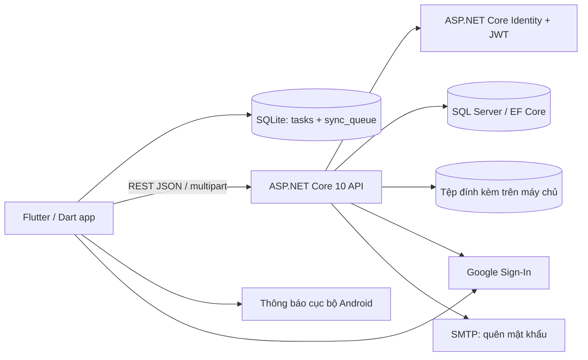
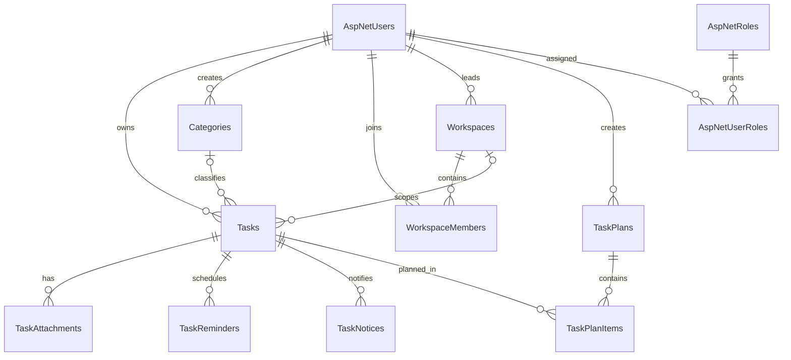
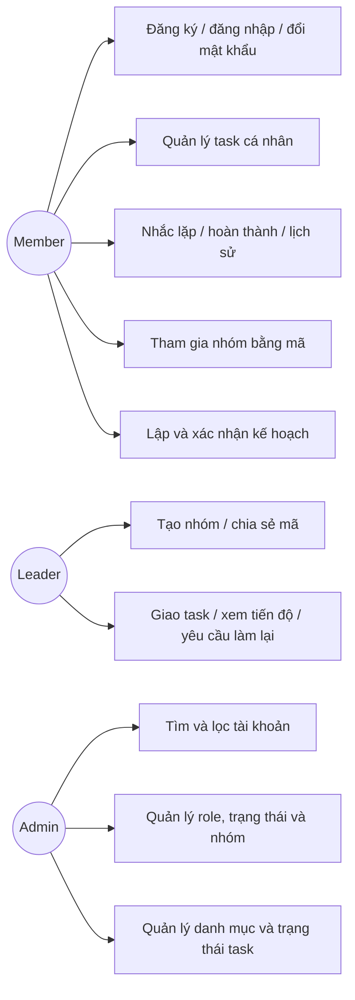

# Kiến trúc và kịch bản demo TaskFlow

## Kiến trúc

Flutter giữ bản cache task ở SQLite và hàng đợi thao tác offline. API là nguồn dữ liệu dùng chung, xác thực JWT, kiểm tra role và quyền thành viên nhóm. Android lập lịch nhắc việc cục bộ; SMTP và Google cần thông tin cấu hình môi trường.

## ERD SQL Server

`WorkspaceMembers.LeftAt` giữ lịch sử rời nhóm. `TaskPlans.ConfirmedAt` phân biệt kế hoạch nháp và đã xác nhận. Task được tham chiếu trong `TaskPlanItems` không xóa được cho đến khi người dùng gỡ task hoặc xóa kế hoạch.

## Use case

## Ma trận quyền

| Tác vụ | Member | Leader | Admin |
|---|---:|---:|---:|
| Tạo/sửa/xóa task cá nhân | Có | Có | Có |
| Tạo task nhóm và giao thành viên | Không | Có trong nhóm do mình dẫn dắt | Có theo quyền admin |
| Hoàn thành task được giao | Có | Có | Có |
| Yêu cầu làm lại task thành viên | Không | Có | Có |
| Tạo/join/rời nhóm | Có | Có, giới hạn không rời khi còn thành viên | Có thêm công cụ quản trị |
| Quản lý member toàn hệ thống và role | Không | Không | Có |
| CRUD danh mục | Không | Không | Có |
| Tìm/lọc task và đổi trạng thái trong trang quản trị | Không | Trong phạm vi nhóm | Có |

## API theo nghiệp vụ

| Nghiệp vụ | Endpoint tiêu biểu |
|---|---|
| Auth | `POST /api/auth/register`, `/login`, `/change-password`, `/forgot-password`, `/reset-password`, `/google/login`, `/google/link` |
| Member/Admin | `GET/POST /api/admin/members`, `PUT /api/admin/members/{id}/role`, `PUT /api/admin/members/{id}/status` |
| Categories | `GET/POST /api/categories`, `PUT/DELETE /api/categories/{id}` |
| Tasks | `GET/POST /api/tasks`, `GET/PUT/DELETE /api/tasks/{id}`, `PATCH /api/tasks/{id}/status`, `POST /api/tasks/{id}/request-rework` |
| Upload | `GET/POST /api/tasks/{id}/attachments`, download/delete attachment routes |
| Nhóm | `/api/groups`, `/api/groups/join`, `/api/groups/{id}/leave`, `/api/groups/history` |
| Kế hoạch | `GET/POST /api/plans`, thêm/sửa lịch/gỡ item, `/confirm`, delete plan |

`GET /api/tasks` hỗ trợ page/pageSize, q, status, categoryId, from/to, workspaceId, ownerId và sort=newest.

## Dữ liệu demo Development

`DatabaseSeeder` tạo tài khoản và dữ liệu khi `ASPNETCORE_ENVIRONMENT=Development`:

- `phat.nguyen` — Nguyễn Đức Phát, Admin/nhóm trưởng.
- `anh.bui` — Bùi Đức Anh, Member.
- Email demo dùng domain nội bộ `taskflow.local`, không nhận email thật.
- Mật khẩu seed Development: `TaskFlow@2026`; không dùng trên máy chủ thật.
- Nhóm demo `TaskFlow - Nhóm đồ án`, mã `TFLOW26A`, danh mục và sáu công việc mẫu.

SQLite tạo `taskflow.db` trên app. API Development tạo/nâng bảng SQL Server, gồm cả `TaskPlans` và `TaskPlanItems`.

## Kịch bản trình diễn

1. Đăng nhập Member; tạo task có danh mục, hạn và nhắc lặp; sửa task và xem trang chi tiết.
2. Lọc theo danh mục; cuộn “Tải thêm”; tìm kiếm task.
3. Chọn nhiều task tạo kế hoạch; xếp giờ; xác nhận; thử gỡ/xóa sau khi xác nhận để minh họa trạng thái khóa.
4. Đăng nhập Leader; giao task cho Bùi Đức Anh; hoàn thành ở tài khoản Member; yêu cầu làm lại và xem notification.
5. Đăng nhập Admin; tìm/lọc account theo ngày tạo; đổi role/trạng thái; quản lý danh mục; lọc task theo hạn và trạng thái rồi cập nhật.
6. Chụp ảnh màn hình các luồng trên cho báo cáo. Không đưa ảnh có email thật, OAuth secret, SMTP password hoặc token vào GitHub.

## Hình ảnh đề xuất cho báo cáo

- Đăng nhập và form đổi mật khẩu.
- Tổng quan task có filter danh mục và badge.
- Form tạo/sửa task có category/deadline/reminder.
- Tab kế hoạch: bản nháp, xếp giờ, kế hoạch đã xác nhận.
- Nhóm: mã tham gia, giao việc, thông báo yêu cầu làm lại.
- Admin: account search/date filter, role, category CRUD, task status/date filter.
- Bằng chứng SQLite trên thiết bị và SQL Server tables/seed data.

Không commit screenshots chứa dữ liệu cá nhân thật hoặc secrets.
